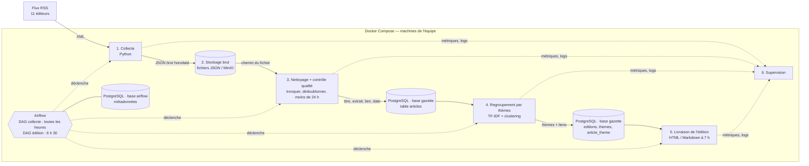

# La gazette — note de cadrage

*Équipe : `CYA` · Version du 13/11/2026 · TD 1*

## Le besoin

Chaque matin à 7 h, La gazette publie une revue de presse automatique : **quels sujets occupent aujourd'hui les rédactions régionales et nationales**. Pour chaque thème, l'édition indique les journaux qui en parlent et donne les liens vers leurs articles. Le pipeline lit uniquement ce que les éditeurs mettent à disposition des machines, c'est-à-dire leurs flux RSS. Il doit tourner seul, tous les jours, en restant observable et reproductible.

## Périmètre

| Dedans | Dehors |
|---|---|
| Collecte de 11 flux RSS (5 PQN, 6 PQR), listés dans `sources.csv` | Texte intégral des articles, scraping HTML |
| Conservation du titre, d'un extrait (≤ 300 caractères), du lien, de la date et de la rubrique | Résumé des articles par un LLM |
| Nettoyage, dédoublonnage, filtre « moins de 24 h » | Front soigné |
| Regroupement des articles par thèmes | Commentaires, profils, noms d'auteurs, images |
| Publication d'une édition HTML / Markdown à 7 h | Sources qui interdisent les robots ou les bloquent |
| Supervision : réussite des tâches, volume par source, alertes | Nouvelles fonctionnalités : le temps en trop va à la robustesse |

## Contraintes

- **7 h** : l'édition est construite à 6 h 30 et publiée à 7 h.
- **Moins de 24 h** : on filtre sur `pubDate`. Certains flux contiennent des articles vieux de plusieurs mois (La Dépêche, 20 Minutes).
- **Conditions des éditeurs** : `robots.txt` vérifié pour chaque flux, CGU vérifier. User-Agent qui nous identifie, au plus une requête par flux et par heure, mention de la source et lien obligatoire vers l'article.
- **Aucune donnée personnelle** : on supprime `dc:creator` / `author`, et on ne collecte ni commentaires ni profils.
- **Budget zéro** : tout tourne sur nos machines avec Docker Compose, en attendant l'infrastructure fournie au TD 4 ou 6.

## Stack retenue et pourquoi

| Brique | Choix | Pourquoi |
|---|---|---|
| Accès à la presse | **Flux RSS**, lus avec `feedparser` (Python) | Format prévu pour les machines, stable, accès autorisé |
| Orchestration | **Apache Airflow** | Dépendances entre tâches, relances automatiques, historique des exécutions, interface de suivi |
| Stockage brut | **Fichiers JSON horodatés** sur un volume ou dans **MinIO** | Immuable et rejouable ; MinIO, compatible S3, facilitera la mise en production |
| Stockage propre et thèmes | **PostgreSQL** (base `gazette`) | Dédoublonnage par contrainte d'unicité sur le lien, filtre 24 h en SQL ; base `airflow` séparée sur le même serveur |
| Regroupement | **TF-IDF + clustering** (`scikit-learn`) | Simple, explicable, sans GPU ; les embeddings restent une évolution possible (pgvector) |
| Supervision | Interface et alertes Airflow, métriques par source (**Prometheus + Grafana**) | Repérer tout de suite une source vide ou une tâche en échec |
| Infrastructure | **Docker Compose**, puis Terraform quand l'infra sera fournie | Reproductible sur chaque machine de l'équipe |

**Rythme** : le DAG *collecte* tourne toutes les heures (collecte puis nettoyage), car certains flux ne couvrent que 4 à 6 h (Sud Ouest, Nice-Matin). Le DAG *édition* tourne à 6 h 30 (regroupement puis livraison).

## Alternatives écartées et pourquoi

- **Scraping HTML** : fragile, souvent interdit, et il récupère du texte intégral.
- **cron** : pas de relance, pas d'historique, pas de dépendances entre tâches.
- **Prefect** : solide, mais Airflow est plus répandu et mieux documenté pour notre cas.
- **SQLite** : écritures concurrentes mal gérées, déconseillé avec Airflow.
- **MongoDB** : nos données sont simples et structurées ; PostgreSQL stocke aussi du `JSONB` si besoin.
- **Elasticsearch** : trop lourd, et la recherche plein texte n'est pas notre besoin.
- **Sources écartées** :
  - Ouest-France : `robots.txt` interdit les robots génériques.
  - La Voix du Nord et Le Télégramme : accès bloqué (HTTP 403).
  - Les Échos : flux instable.
  - Le Parisien : pas de date dans le flux.
  - 20 Minutes : gardé en réserve, car son flux contient le texte intégral, qu'il faudrait supprimer.

## Risques

| Risque | Parade |
|---|---|
| Un flux change d'adresse, de format, ou bloque l'accès | Alerte « 0 article reçu » par source ; source de secours (Le Dauphiné, 20 Minutes) |
| Flux trop court, articles manqués | Collecte toutes les heures et dédoublonnage |
| Contenu interdit stocké par erreur (texte intégral, auteur) | Liste blanche des champs gardés et troncature, vérifiées par un test |
| Thèmes peu lisibles | Étiquettes faites des mots les plus représentatifs ; seuil minimal d'articles par thème |
| Édition en retard | Alerte si l'édition n'est pas publiée à 7 h ; possibilité de relancer depuis Airflow |
| Opposition des éditeurs à la fouille de données (TDM) | Vérifier les CGU et `tdmrep.json` ; écarter la source en cas d'opposition explicite |

## Schéma d'architecture

## Rôles dans l'équipe

| Membre | Rôle |
|---|---|
| Cheick | Collecte et données : DAG collecte, stockage brut, nettoyage, schéma PostgreSQL |
| Yoann | Thèmes et livraison : regroupement, édition de 7 h |
| Aurelien | Infra et supervision : Docker Compose, Airflow, PostgreSQL et MinIO, alertes |

**Tous les trois** : choix des sources et vérification à la main des flux et des CGU. Chacun relit le code des deux autres avant son intégration, pour que personne ne soit seul à connaître une brique.

